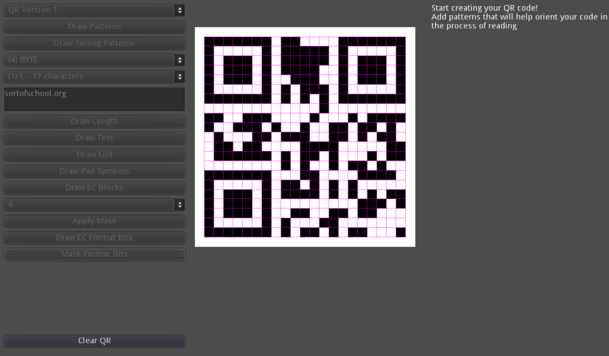

# Step-by-Step QR Code Generator

## Builds
1. **Executable**: You can find `.exe` in the `_export` folder.
2. **Web Version**: You can find it on [my website](https://sortofschool.org/tools/qr/)

## Important Notes
- Follow buttons from top to bottom. Skipping steps may lead to incorrect representation of the QR code.
- Built with Godot v3.5.1
- Supports only Version 1 of QR codes (21x21 matrix size)
- Operates only in byte-mode

## Attribution
- [**"An Introductory Tutorial For Encoding QR Codes"**](https://zavier-henry.medium.com/an-introductory-walkthrough-for-encoding-qr-codes-5a33e1e882b5) by Zavier Henry
- [**"QR Code Tutorial"**](https://www.thonky.com/qr-code-tutorial/introduction) by Thonky
- [**"Reed-Solomon Error Correcting Codes from the Bottom Up"**](https://tomverbeure.github.io/2022/08/07/Reed-Solomon.html) by tomverbeure

